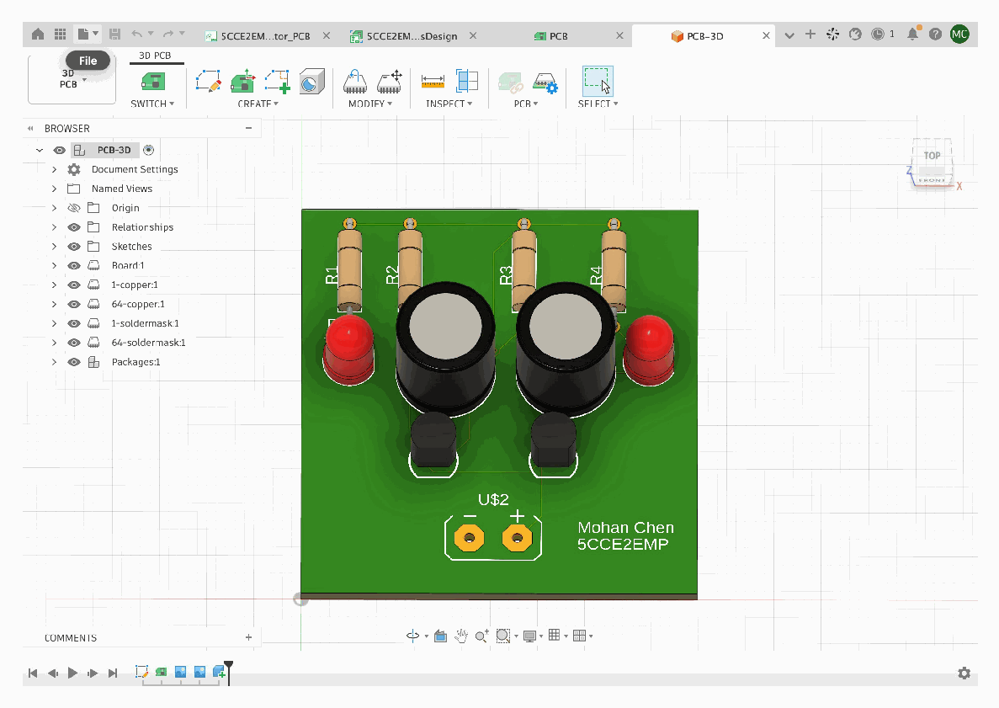

# Engineering Research & Design Portfolio

Engineering projects exploring reliability, circuit behavior, and hardware implementation through simulation, statistical analysis, and design verification. This portfolio connects computational engineering studies with circuit and PCB design. Each project states its question, assumptions, evidence, reproducibility steps, and limitations.

## Selected projects

### SRAM reliability under process variation — computational study

**Question:** How do modeled transistor-threshold variation and supply-voltage scaling affect the stability of a 6T SRAM bit cell?

**Method:** A vectorized Python/NumPy Monte Carlo model evaluates static noise margin (SNM), with analysis across 10,000 randomized cells and multiple supply voltages.

**Reported result:** At VDD = 1.0 V, the repository reports a mean SNM of 229.1 mV, a 12.1 mV standard deviation, and 8 of 10,000 cells below a 180 mV threshold.

**Scope:** This is a behavioral statistical study. Interpret the results within the model assumptions; they are not foundry process-corner simulations or silicon measurements.

[Open the SRAM project repository](https://github.com/c18663979619-cpu/sram-reliability-monte-carlo)

### 9 V BJT astable multivibrator — circuit and PCB design

**Question:** Can a cross-coupled NPN multivibrator be designed for approximately 3 Hz operation and laid out as a compact two-layer LED-flasher PCB?

**Method:** Component selection, transient SPICE analysis, schematic checks, and Autodesk Fusion Electronics PCB layout. This is an individual course design project for 5CCE2EMP.

**Reported result:** The simulated oscillation is approximately 2.91 Hz; the 41.9 × 44.1 mm board is within the 50 × 50 mm limit, with one via and zero airwires. The submitted report records zero ERC/DRC errors and warnings. A later Fusion PCB check shows zero errors and 12 warnings, including solder-mask warnings after a design-rule update; those warnings have not yet been reviewed.

Editable schematic and board exports are included in the PCB project's `source/` folder. The full simulation setup still needs model and version details.

[Open the PCB case study](projects/bjt-astable-multivibrator-pcb/README.md)

## How I work

- Define the engineering question and success criterion.
- State model assumptions, component values, and analysis settings.
- Show evidence that supports each conclusion.
- Separate simulation from physical measurement.
- Record limitations and practical next steps.

## Current focus

Building a coherent portfolio across electronics, computer engineering, reliability modeling, and reproducible engineering analysis.
