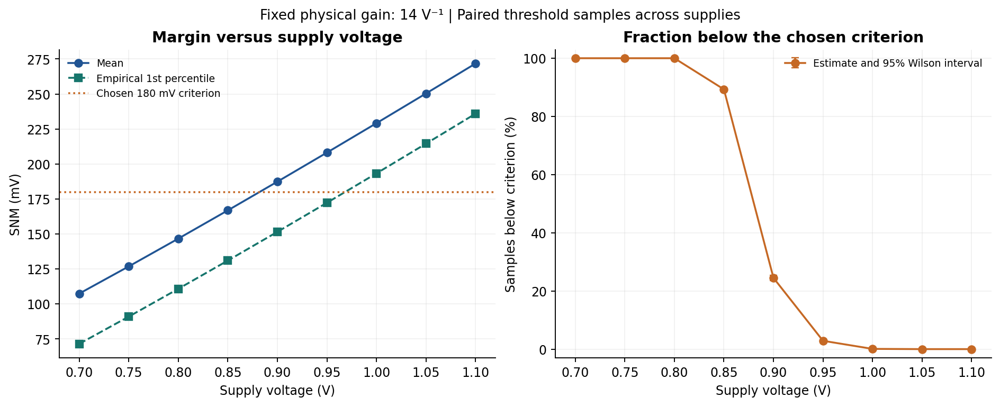
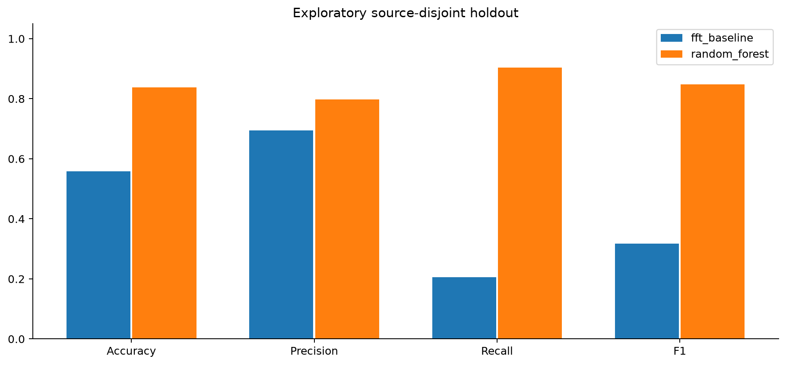

# Mohan Chen | Engineering Research & Design Portfolio

Projects exploring **electronics and computer engineering** through circuit analysis, numerical modeling, and hardware design. Each case study connects an engineering question with an explicit method, evidence, reproducible artifacts, and limitations.

## Selected projects

| Project | Engineering question | Work demonstrated | Evidence |
|---|---|---|---|
| [Behavioral SRAM stability](https://github.com/c18663979619-cpu/sram-reliability-monte-carlo/tree/70023883ea8ac17d4296a5396efb0eae3d4ac80e) | How do threshold mismatch and supply assumptions affect static stability? | Python/NumPy modeling, Monte Carlo analysis, numerical verification, uncertainty | Executed notebook, 10,000 samples, four figures, data and tests |
| [BJT oscillator and PCB](projects/bjt-astable-multivibrator-pcb/) | How can an approximately 3 Hz oscillator be analyzed and translated into a compact PCB? | Circuit calculations, SPICE interpretation, schematic capture, placement and routing | Reported waveforms, native Fusion exports, BOM, check records |
| [ML surrogate for behavioral SRAM stability — In progress](projects/ml-sram-surrogate/) | Can regression approximate numerical stability calculations, and where does it fail? | Initial dataset preparation and NumPy regression baselines; nonlinear methods planned | Reproducible split, initial error table, prediction plot |
| [Smart Scarecrow ML — Research prototype](projects/smart-scarecrow-ml/) | Can audio classification distinguish birds from environmental sounds on a resource-limited scarecrow? | Audio DSP, source-disjoint ML evaluation, AVR memory optimization and serial acquisition | 160 sourced audio clips, 19 passing tests, four compiled firmware variants and a real 30-frame capture |

## 01 · Computational modeling: behavioral SRAM stability

**Method.** Model a pair of cross-coupled inverter voltage-transfer curves, apply independent threshold variation, and extract static noise margin over 10,000 samples and nine supply voltages. Compare the batched calculation against an independent reference and quantify finite-sample uncertainty.

**Result.** At 1.0 V and assumed threshold σ = 40 mV, mean SNM is **229.15 mV**. **8/10,000** samples fall below the chosen 180 mV criterion; the 95% Wilson interval is **0.041–0.158%**. Numerical comparisons on 66 cases at three supplies agree within **0.002 mV** at the default grid.

*Review snapshot using a fixed physical gain of 14 V⁻¹. The model is behavioral and uncalibrated; the results do not establish read/write yield or silicon reliability. This figure and the linked immutable revision belong to the same revision.*

[Read the study and reproduce it →](https://github.com/c18663979619-cpu/sram-reliability-monte-carlo/tree/70023883ea8ac17d4296a5396efb0eae3d4ac80e)

## 02 · Circuit and hardware design: BJT astable multivibrator

**Method.** Size the timing network, interpret transient switching, adapt the schematic for a battery and LEDs, and place/route a two-layer through-hole PCB. Completed as an individual 5CCE2EMP course design project.

**Result.** The report's pre-LED simulation gives approximately **2.91 Hz**. The final CAD board is approximately **41.9 × 44.1 mm**, with **one via and zero airwires**. Native schematic/board exports, analytical calculations, and a traceable BOM are included.

*The waveform predates the LED adaptation. A later PCB check shows 12 warnings awaiting review; fabrication and bench measurements are not documented. The case study explains these verification boundaries and the next steps.*

[Explore the design case study →](projects/bjt-astable-multivibrator-pcb/)

## 03 · Machine learning for circuit analysis — In progress

**Question.** Can a learned surrogate approximate the behavioral SRAM calculation accurately enough to support faster parameter studies?

**Current milestone.** Reuse 10,000 synthetic samples at 1.0 V, fit training-mean and linear-regression baselines, and evaluate on 2,000 held-out samples. Both give approximately **9.57 mV MAE**; raw linear regression offers no meaningful improvement. Nonlinear modeling, multi-voltage generalization, and timing experiments are planned.

[View the initial experiment and roadmap →](projects/ml-sram-surrogate/)

## 04 · Embedded audio classification: Smart Scarecrow ML

**Method.** Extract 37 acoustic features and compare a fixed FFT rule with a 200-tree Random Forest. Keep original recordings disjoint across training and testing, and investigate a validation-only decision threshold. Integrate with the Kona328 / ATmega328P sensor and actuator pin map.

**Evidence.** On 640 held-out windows from 28 recording sources, RF achieves **83.75% accuracy** and **0.8475 Bird F1**, versus **55.78%** and **0.3181** for the FFT baseline. A real Kona328 capture contains **30 complete frames / 7,680 ADC samples**. The original controller's static SRAM falls from **1,767 B to 939 B** in a separate repaired version.

*The RF false-positive rate is 22.81%, above the FFT baseline's 9.06%. Field false-alarm reduction has not been demonstrated. The current model runs on a host; the UNO handles acquisition/control. Source audio and model binaries are not published.*

[Explore the project, code, report and reproducibility guide →](projects/smart-scarecrow-ml/)

## Research approach

- Start with a question and a measurable criterion.
- Make assumptions visible and compare theory with available evidence.
- Preserve sources and parameters so another person can inspect the work.
- Test numerical methods and separate simulation, design checks, and measurement.
- Use discrepancies to identify the next useful experiment.

**Current interests:** electronic circuits, computer engineering, reliability modeling, and reproducible engineering analysis.

