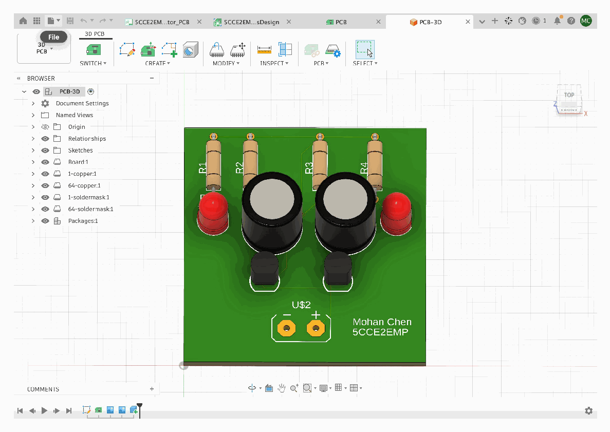
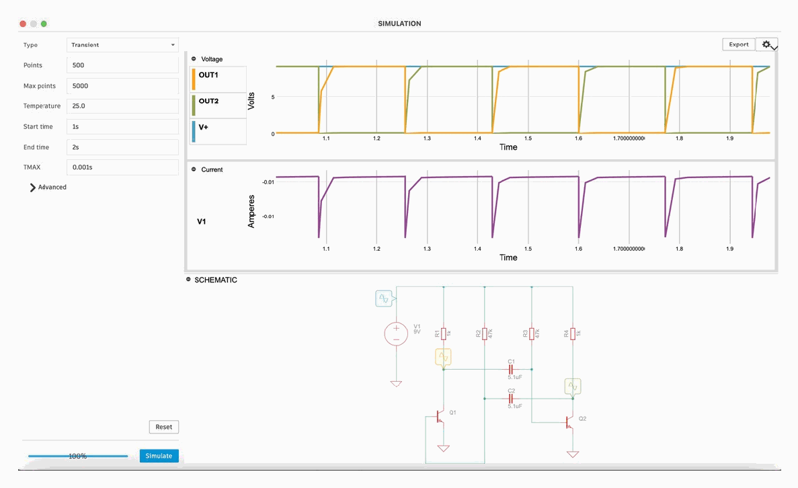
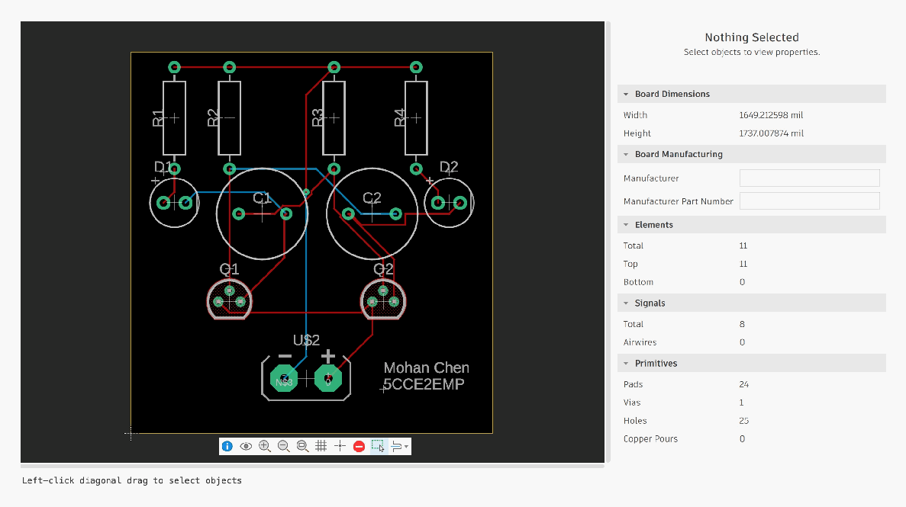

# 9 V BJT Astable Multivibrator: Analysis to PCB

**A circuit and hardware design case study by Mohan Chen · Individual project, 5CCE2EMP · Autodesk Fusion Electronics**

Design a symmetrical transistor oscillator near 3 Hz, examine its switching behavior, and translate the circuit into a compact two-layer LED-flasher PCB. The project brings together RC timing analysis, transient SPICE evidence, component footprints, routing, and design-rule review.

*CAD preview from the submitted report. The available evidence covers design and simulation; fabrication and bench measurements are not documented.*

[Design analysis](docs/design-analysis.md) · [Verification record](docs/verification.md) · [Reproduction](docs/reproducibility.md) · [BOM](BOM.csv) · [Native design files](source/) · [Portfolio](../../README.md)

## Project at a glance

| Design item | Evidence / result |
|---|---|
| Target | 3 Hz ±20% (2.4–3.6 Hz); outline within 50 × 50 mm |
| Timing network | Two 47 kΩ base resistors and two 5.1 µF coupling capacitors |
| Frequency estimates | 3.02 Hz first-order; approximately 2.89 Hz with assumed junction drops |
| Reported transient result | Approximately 2.91 Hz in the **pre-LED simulation circuit** |
| Final PCB circuit | 9 V battery connector, two NPN devices, two red LEDs, two 1 kΩ collector resistors |
| Layout | Approximately 41.9 × 44.1 mm; two copper layers; 1 via; 0 airwires |
| Verification status | Historical report: 0 ERC/DRC errors and warnings. Later PCB screenshot: 0 errors, 12 warnings awaiting review |

## Engineering decisions

**Timing.** With 47 kΩ fixed by the course brief, the first-order equation gives a target capacitance of 5.14 µF. The design uses 5.1 µF. The nominal frequency satisfies the target, while a ±20% capacitor range alone gives approximately 2.52–3.78 Hz, so full tolerance compliance has not been established.

**Simulation to hardware.** The simulation uses an ideal 9 V source. The final schematic replaces it with a battery connector and adds LEDs in the collector branches. The estimated LED current is 6.8 mA using assumed 2.0 V LED and 0.2 V transistor drops. The recorded 2.91 Hz waveform precedes this change; it does not verify the final LED-loaded circuit's frequency.

**Placement and routing.** A symmetric placement keeps the timing capacitors close to the transistor nodes. LEDs sit at the outer edges and the battery connector sits at the bottom for access. A bottom-layer segment and one via accommodate a feedback crossing. The archived board contains one via and no unrouted airwire segments.

## Results and evidence

### Circuit behavior

*Report Figure 3: ideal 9 V source, pre-LED collector circuit; transient window 1–2 s, 25 °C, maximum time step 1 ms. Rounded transition readings give a half-period of about 0.172 s and a frequency of 2.91 Hz. This is screenshot-based evidence; raw waveform data and an exact simulation rerun are not included.*

The junction-drop estimate helps explain the difference from the first-order 3.02 Hz result. It is an analytical approximation with assumed voltages, rather than a fitted transistor model. [Equations, assumptions, and reproducible arithmetic](docs/design-analysis.md).

### Final PCB circuit and layout

*Report Figure 4: final PCB schematic, including the battery connector and LEDs. Its historical ERC panel reports schematic/board consistency and zero errors/warnings.*

*Report Figure 5: completed routing and board outline. This is layout evidence; manufacturing-rule acceptance is tracked separately.*

## Contribution and project context

Completed as an individual course design project. The brief supplied the oscillator topology, target frequency, fixed resistor values, package constraints, and board limit. The work presented here includes timing calculations, schematic capture, transient analysis, the battery/LED adaptation, component placement, routing, and discussion of failure mechanisms.

The portfolio revision adds explicit evidence provenance, reproducible calculations, source inspection, and a clearer account of unresolved checks. The submitted report and assignment brief are not redistributed here. The Fusion source exports are preserved without circuit or layout modifications.

## Reproduce or inspect

- Open the `.fsch` and `.fbrd` files in [source/](source/) using Fusion Electronics; see [the inspection and association workflow](docs/reproducibility.md).
- Recalculate the analytical values with standard Python: `python analysis/design_calculations.py` from this project directory.
- Inspect the archive contents without Fusion: `python scripts/inspect_sources.py`. This writes [the source inventory](docs/source-inventory.json).
- Consult [the verification record](docs/verification.md) before interpreting a historical DRC screenshot as the current status.

## What the next revision should establish

1. Select an exact transistor and LED, check pin mapping and component ratings, and document capacitor polarity and availability.
2. Simulate the final LED circuit with documented device models and startup conditions, recording frequency, duty cycle, and base-emitter stress.
3. Resolve the 12 later PCB warnings with recorded rules and evidence; then prepare manufacturing outputs if fabrication is intended.
4. Evaluate timing tolerances and, if hardware is built, compare measured waveforms with simulation.

These are follow-up steps, not completed results. See [design analysis](docs/design-analysis.md) for the specific reverse-bias and tolerance issues that motivate them.
