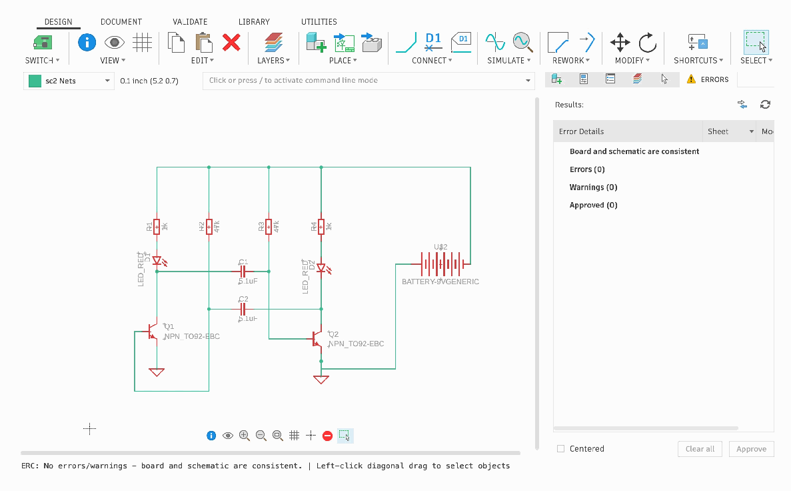
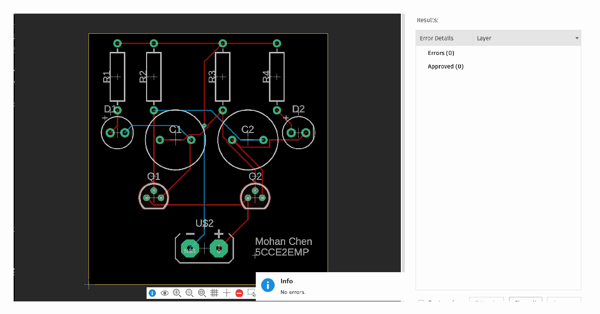

# 9 V BJT Astable Multivibrator PCB

A course design project documenting the analysis, transient SPICE simulation, and two-layer PCB layout of a battery-powered LED flasher in Autodesk Fusion Electronics.

## Project snapshot

| Item | Result |
|---|---|
| Circuit | Symmetrical two-NPN BJT astable multivibrator |
| Supply | 9 V |
| Timing components | 47 kΩ base resistors; 5.1 µF coupling capacitors |
| Collector / LED resistors | 1 kΩ |
| Design target | 3 Hz ±20% (2.4–3.6 Hz) |
| First-order frequency estimate | 3.02 Hz |
| Simulated frequency | Approximately 2.91 Hz |
| PCB | Two copper layers; approximately 41.9 × 44.1 mm |
| Routing evidence | 1 via; 0 airwires |
| Reported checks | ERC and DRC: 0 errors and 0 warnings |

The simulated frequency is within the target range. The two collector outputs switch in opposite phases, driving the two red LEDs alternately in the PCB design.

## Engineering question

Can a symmetrical, cross-coupled NPN multivibrator use practical RC values to oscillate near 3 Hz, and can the simulated circuit be translated into a compact two-layer PCB with the required checks passing?

## Design and evidence

### PCB schematic

### Transient simulation

The report estimates a first-order frequency of 3.02 Hz using 47 kΩ and 5.1 µF timing components. The transient simulation gives approximately 2.91 Hz, within the specified 2.4–3.6 Hz range.

### PCB layout and design checks

The reported board dimensions are 41.9 × 44.1 mm, within the 50 × 50 mm limit. The board has one via and no unrouted airwires. The report records zero ERC and DRC errors and warnings.

## Bill of materials

See [BOM.csv](BOM.csv) for component values and package information.

## Reproducing the reported simulation

The submitted report records these Fusion Electronics transient-analysis settings:

- Analysis: transient
- Points: 500; maximum points: 5000
- Temperature: 25 °C
- Start time: 1 s; end time: 2 s
- Maximum time step: 1 ms

The report does not include the editable Fusion design file, full simulator model definitions, or the exact Fusion version. Therefore, the figures and numeric results here document the submitted work, but this repository is not yet a complete rerun package. Add the native schematic/board source and any custom model files before describing the project as fully reproducible.

## Design limitations and next steps

- The report identifies possible reverse base-emitter voltage stress in the 9 V circuit. Check the selected transistor model and datasheet limits, then add a suitable protection strategy and repeat simulation before building hardware.
- The supplied evidence documents a Fusion design and simulation. It does not establish that a physical PCB was manufactured or bench-tested.
- A next revision could add test points, mounting holes, capacitor-polarity markings, and a documented physical validation plan.

## Project context

Completed as an individual design project for module 5CCE2EMP. This repository presents a concise engineering case study; it does not reproduce the assignment brief or include the submitted report.

## Repository contents

- [BOM.csv](BOM.csv) — bill of materials
- [docs/figures/](docs/figures/) — schematic, waveform, PCB layout, DRC, and 3D-view evidence
- [docs/reproducibility.md](docs/reproducibility.md) — source files needed for a complete rerun package
