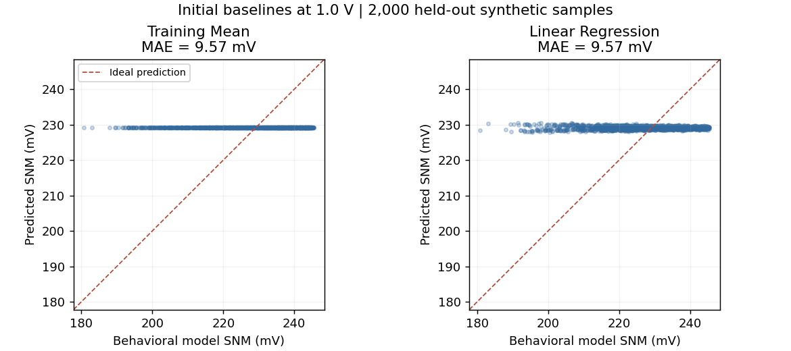

# ML Surrogate for Behavioral SRAM Stability

**Status: In progress · Milestone 0 — data preparation and initial baselines**  
Started: 16 November 2026 · Author: Mohan Chen

A learning project exploring machine learning for electronic circuit analysis. The research question is whether a regression model can approximate a numerical static-noise-margin (SNM) calculation accurately enough to support faster parameter studies, and where that approximation breaks down.

This first milestone uses the existing [behavioral SRAM study](https://github.com/c18663979619-cpu/sram-reliability-monte-carlo/tree/70023883ea8ac17d4296a5396efb0eae3d4ac80e). It establishes a reproducible dataset and deliberately simple regression baselines. Nonlinear prediction and any computational speed benefit remain open questions.

## Current progress

- [x] Define four threshold-voltage inputs and the SNM regression target.
- [x] Pin and verify the existing 10,000 synthetic samples at 1.0 V.
- [x] Create a reproducible 8,000/2,000 training/evaluation split by sample ID.
- [x] Fit a training-mean baseline and ordinary linear regression using NumPy.
- [x] Record initial errors and plot predictions against numerical-model labels.
- [ ] Learn and implement a nonlinear model, beginning with random forest regression.
- [ ] Compare raw inputs with features motivated by inverter mismatch.
- [ ] Add per-sample labels at multiple supply voltages and split by sample group.
- [ ] Evaluate low-margin errors, generalization, and end-to-end computational cost.

## First experiment

| Item | Definition |
|---|---|
| Inputs | `vth_n1_v`, `vth_p1_v`, `vth_n2_v`, `vth_p2_v` (volts) |
| Target | `snm_1v_mv`, calculated by the source behavioral model (millivolts) |
| Supply | Fixed at 1.0 V in this milestone |
| Samples | 10,000 independent parameter draws; one row per sample |
| Split | NumPy `default_rng(42)` permutation; first 8,000 train, remaining 2,000 evaluate |
| Fit | Training mean; least squares with an intercept and training-only centering |

| Baseline | Evaluation MAE (mV) | Evaluation RMSE (mV) | Evaluation R² |
|---|---:|---:|---:|
| Predict the training mean | 9.5668 | 11.8222 | −0.00010 |
| Linear regression on four thresholds | 9.5650 | 11.8274 | −0.00097 |

**Initial finding:** raw linear regression performs almost like a constant predictor. Its tiny MAE change is not evidence of useful improvement, and its RMSE is slightly worse. A plausible explanation is the nonlinear, weaker-lobe dependence of SNM on mismatch; a feature or nonlinear-model comparison is needed to investigate this explanation.



Both panels use the same limits and all 2,000 evaluation samples. The dashed line indicates ideal agreement. The near-horizontal predictions make the limitation visible. This is a baseline record, not a successful surrogate model.

## Reproduce this milestone

Use Python 3.12 from this project directory:

```bash
python3 -m venv .venv
source .venv/bin/activate
# Windows PowerShell: .venv\Scripts\Activate.ps1
python -m pip install -r requirements.txt
python fetch_data.py
python baseline.py
```

The first data download needs internet access and no GitHub credentials. `fetch_data.py` verifies SHA-256 hashes against [data/source.json](data/source.json); subsequent runs can use the verified local cache. Raw data stay in ignored `data/raw/` because the complete files already live in the source repository.

`baseline.py` checks source hashes, ordered unique IDs, finite data, and training/evaluation separation. It fits both baselines using only the training partition and regenerates:

- [results/baseline_metrics.csv](results/baseline_metrics.csv): full-precision evaluation metrics.
- [results/experiment.json](results/experiment.json): source revision, environment, split hashes, fitted coefficients, and script hash.
- [figures/baseline_predictions.png](figures/baseline_predictions.png): the initial comparison figure.

The recorded run used Python 3.12.6, NumPy 2.3.5, and Matplotlib 3.10.7. Small floating-point differences can occur across numerical libraries and platforms.

## What to study next

1. Follow each array in `baseline.py`: `x` contains four inputs and `y` contains the label to predict.
2. Explain why the constant baseline uses the training mean and why centering uses training data only.
3. Learn scikit-learn's `fit`, `predict`, cross-validation, and random forest regression; compare models within the training partition.
4. Inspect the source model's switching-point rule and weaker-lobe operation before proposing new features.

This milestone's evaluation results are already visible. They should be treated as development evidence during later work. Freeze model choices before evaluating on a fresh, independently generated final dataset. When adding multiple voltages per sample, keep every row with the same underlying sample ID together in one partition; supply extrapolation needs a separate experiment.

## Scope and limitations

Labels come from two sigmoid inverter transfer curves with assumed variation. They are numerical outputs, not transistor-level SPICE or silicon measurements. Predicting these labels cannot establish physical SRAM reliability. This is an extension of the existing SRAM study, not an independent experimental dataset.

Only one split and one supply are evaluated. No hyperparameter search, nonlinear model, classification result, or timing study is included. Only eight source samples are below the illustrative 180 mV criterion, and none fall in this evaluation partition. These metrics therefore do not evaluate that rare-event region. No acceleration claim is made until both prediction error and relevant computational costs have been measured.

This project is at an early learning stage. Further milestones will be added as the methods are studied and implemented.
