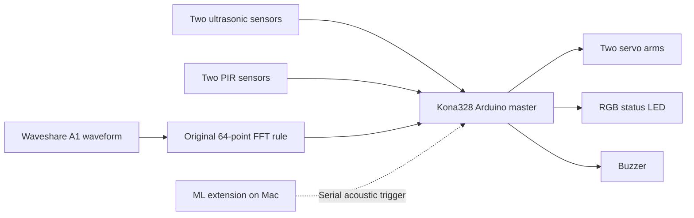
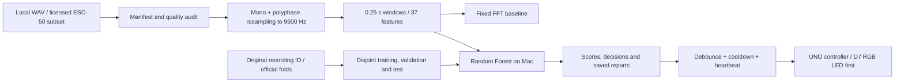
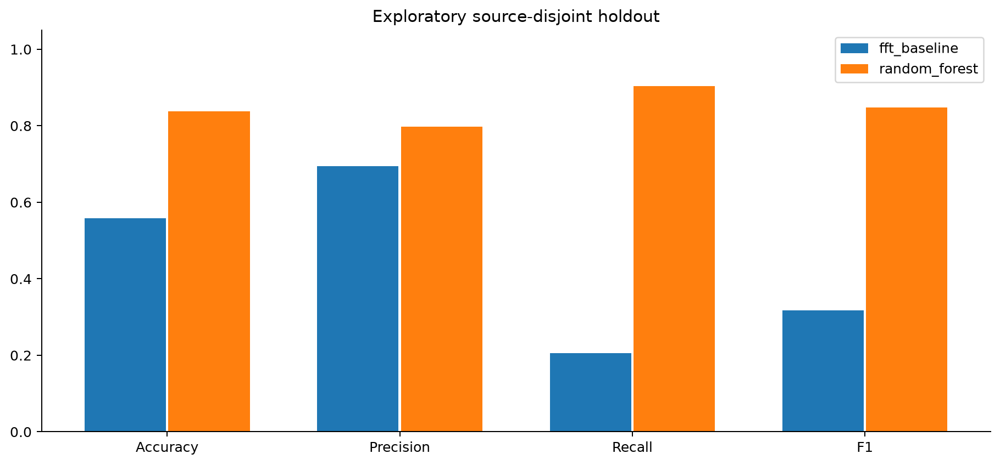
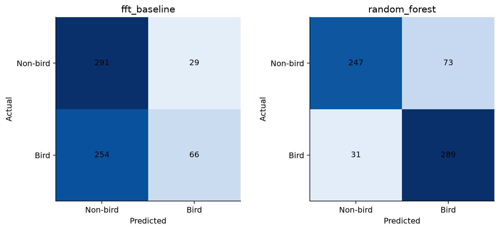

# Smart Scarecrow — Arduino Hardware & Machine Learning

**From a completed school hardware project to an experimental ML-enhanced acoustic detector.**

I developed the Arduino control program for a school Smart Scarecrow project: **five sensors, two servo-driven arms, an RGB LED and a buzzer**, integrated on an Orangepip Kona328 (ATmega328P / Arduino UNO compatible). This repository preserves that original work and extends its sound-detection channel with audio features and machine learning. The aim is to distinguish Bird from Non-bird sounds more reliably and reduce unwanted acoustic triggers.

**Start with my original Arduino work:** [complete five-sensor master code](firmware/originals/5CCE2EMP_Control_SG90_HC-SR04/5CCE2EMP_Control_SG90_HC-SR04.ino) · [hardware engineering case study](docs/HARDWARE_CASE_STUDY.md) · [which firmware to use](firmware/README.md).

| Project stage | Work and evidence | Status |
|---|---|---|
| School hardware project | My Arduino master integrates 2× HC-SR04, 2× PIR and 1× Waveshare sound sensor with servo, RGB and buzzer control | Completed school implementation, as reported by the author; original source preserved |
| Engineering extension | Separate SRAM repair, serial acquisition, host-controlled firmware and real 30-frame ADC capture | Compiled / software-tested; capture analyzed; new actuator firmware not tested on the assembled system |
| Machine-learning extension | FFT baseline, 37 acoustic features, Random Forest and recording-disjoint evaluation | Working research prototype; field false-alarm reduction not yet demonstrated |

中文说明：[硬件设计案例](docs/HARDWARE_CASE_STUDY.md) · [固件选择](firmware/README.md) · [运行指南](docs/RUNNING_ZH.md) · [技术报告](docs/TECHNICAL_REPORT_ZH.md) · [硬件集成方案](docs/HARDWARE_ZH.md)

## 1. Arduino and hardware foundation

The original system combines distance, motion and sound sensing in a **STANDBY → ALARM → COOLDOWN** state machine. Any enabled sensor channel can initiate a 20-second alarm; a 3-second cooldown follows. The controller coordinates two arm servos, alternating RGB indications and the buzzer.

| Hardware | Actual connection | Role in the original controller |
|---|---|---|
| HC-SR04 ×2 | TRIG/ECHO D2/D3 and D12/D13 | Detect objects within 2–50 cm, with echo timeouts |
| PIR ×2 | D4 and A0 | Rising-edge motion detection, 150 ms confirmation and a 2 s settling window |
| Waveshare Sound V2 | AOUT A1; DOUT D5 | A1 waveform sampling, 64-point FFT and a 1,800–4,500 Hz bird-band rule; DOUT is wired but not the FFT input |
| Arm servos ×2 | Right D9; left D10 | Stepped arm movements between standby and alarm positions |
| Common-cathode RGB LED | R D6; G D7; B D8 | Standby, alarm and cooldown indication |
| Buzzer | D11 | Audible alarm coordinated with arm movement |



The original code demonstrates pin/resource planning, ADC acquisition, FFT-based filtering, PIR re-arming, actuator coordination and serial diagnostics. Stepped servo commands are intended to soften movement; supply stability still requires electrical measurement. The original source is unchanged. A separate revision reduces static SRAM from **1,767 B to 939 B**, leaving more room for the stack on a 2 KB MCU.

## 2. Extending the sound channel with machine learning

The ML work builds on this hardware platform. A fixed frequency band can also admit non-bird sounds; the extension tests whether multiple acoustic features can provide better discrimination. The Random Forest and MFCC extraction run on a Mac, while the UNO retains embedded sensing and actuator control. The current host-control path uses the **host microphone**; the separate Waveshare capture path is for target-domain data collection. Simultaneous Waveshare streaming and full servo control has not been validated.

**Experimental result:** public-data classification accuracy improves, but the current RF has a higher non-bird false-positive rate than the experimental FFT baseline. This is not yet proof of a more accurate deployed Waveshare sensor or fewer alarms in the complete scarecrow. The software FFT baseline is a reproducible comparison rule, not a replay of the original Arduino controller.

## What is implemented

- Immutable original experiments and SHA-256 integrity verification.
- Audio/provenance/license audit; explicit recording groups and duplicate checks.
- 37 audio features: RMS, zero crossings, FFT peak, four band-energy ratios, spectral centroid/bandwidth, 13 MFCC means and standard deviations.
- Fixed FFT rule and 200-tree Random Forest using identical preprocessing.
- Recording-disjoint train/test splits; a separate validation-only threshold experiment.
- Offline prediction, optional Mac microphone inference, serial acquisition with CRC and gap detection.
- Compiled UNO sketches for A1 acquisition, D7 LED testing and full-system host ML control; a separate SRAM repair of the original master.
- Automatic figures, saved predictions, model cards, dependency lock, tests and CI configuration.

## ML experiment and host integration architecture



The UNO is an acquisition/control device. The Python Random Forest and MFCC pipeline run on the host; they are not embedded in the UNO.

## Quick start (Python 3.12)

From the portfolio repository, enter `projects/smart-scarecrow-ml`. On the original Mac, the project also remains at `~/Documents/Smart-Scarecrow-ML`. For a fresh checkout, create a Python 3.12 virtual environment first:

```bash
cd projects/smart-scarecrow-ml
python3.12 -m venv .venv
source .venv/bin/activate
python -m pip install -r requirements-dev.txt
python -m pytest -q
python -m scarecrow --help
```

`requirements-lock-macos.txt` records the exact versions tested on this Mac. Linux microphone use also needs PortAudio; file inference does not need microphone access.

Reproduce the local annotated-data demonstration (audio stays private):

```bash
python -m scarecrow run --demo-model
```

Reproduce the licensed public-data experiment:

```bash
# Downloads missing audio; verifies existing files against saved hashes.
python scripts/download_esc50_subset.py
python -m scarecrow run --manifest data/manifest_esc50.csv
# Optional, separate protocol: folds 1–3 train, 4 select threshold, 5 test.
python -m scarecrow run --manifest data/manifest_esc50.csv --calibrate
```

Every run creates a new directory in `results/runs/`. Existing output paths are refused. Models are local, trusted `joblib` files; do not load models from untrusted sources.

## Actual results — 21 November 2026

ESC-50 subset: 160 real five-second clips downloaded; 2 excluded by a fixed quality rule; 158 used. The retained data contains 132 original recording groups. The same Freesound recording ID never crosses partitions. The fixed test is official fold 5: **32 clips, 28 recording groups, 640 windows**. This is a custom binary subset, not the standard ESC-50 50-class benchmark.

| Window-level test measure | FFT rule | RF, threshold 0.5 | RF, validation-selected threshold |
|---|---:|---:|---:|
| Accuracy | 55.78% | 83.75% | 70.00% |
| Bird precision | 69.47% | 79.83% | 79.91% |
| Bird recall | 20.63% | 90.31% | 53.44% |
| Bird F1 | 0.3181 | 0.8475 | 0.6404 |
| Non-bird false-positive rate | 9.06% | 22.81% | 13.44% |

RF at 0.5 trains on folds 1–4. The threshold experiment trains on folds 1–3 and selects its threshold, 0.751742, using fold 4 only; it does not refit. The two RF columns therefore differ in training data as well as decision threshold. The validation FPR was 4.38%, but the test FPR rose to 13.44%. We report this failure rather than tuning on test results.

At the **five-second clip level**, mean-score aggregation yields 90.63% accuracy for the default RF versus 56.25% for FFT. This is a different evaluation unit. All 40 held-out cricket windows were false positives for both RF variants; stronger hard-negative coverage and real field recordings are needed.





Original private dataset: two 1.4-second clips, one source per class. It yields 10 complete windows and **N/A** test metrics. Demo-model predictions are not accuracy measurements. The ESC-50 model also misclassified four of five windows in the existing voice clip, a useful warning about domain shift.

Machine-readable evidence is in [docs/experiments](docs/experiments/). The complete feature tables and trained models remain in local `results/runs/` directories.

## Hardware status

| UNO sketch | Flash | Static SRAM | Scope |
|---|---:|---:|---|
| `uno_audio_capture` | 2,422 bytes | 1,222 bytes | A1, 8 kHz nominal, 10-bit samples, binary serial at 250000 baud |
| `uno_controller` | 2,392 bytes | 247 bytes | D7 RGB LED, heartbeat, 800 ms pulse, 10 s cooldown |
| `scarecrow_host_ml` | 7,634 bytes | 356 bytes | Actual full sensor/servo pin map; starts disarmed |
| `legacy_master_fixed` | 12,370 bytes | 939 bytes | Original master SRAM repair; original was 1,767 bytes |

These are compiler measurements, not on-board timing tests. The user also ran the new legacy capture tool locally: 30 real frames / 7,680 ADC samples were saved and analyzed; they remain unlabeled and discontinuous. No new sketch was uploaded during software verification. See the hardware guide before replacing any existing scarecrow firmware. The 8 kHz acquisition path has a 4 kHz Nyquist limit; resampling it to 9.6 kHz cannot restore missing frequencies.

## Repository layout

```text
scarecrow/             reusable audio, dataset, model, inference and serial modules
scripts/               public-data download and local verification helpers
firmware/              original five-sensor Arduino master and separate extensions
tests/                 synthetic software fixtures, never used as experiment data
data/manifest*.csv     labels, provenance, source groups, licenses and official folds
docs/                  running guide, report, dataset card, figures and evidence
results/runs/          local immutable runs, feature CSVs and model files (ignored)
backups/               original 29-file backup and hashes (ignored)
*.py                   original experimental scripts, preserved unchanged
```

## Data and publication

The ESC-50 dataset is distributed under **CC BY-NC 3.0**, with individual source credits and license tags retained in [the attribution bundle](docs/third_party/esc50/SELECTED_ATTRIBUTIONS.txt). See the [official dataset](https://github.com/karolpiczak/ESC-50) and [upstream license](https://github.com/karolpiczak/ESC-50/blob/master/LICENSE). This public project publishes code, documentation and curated experiment figures; source audio and model binaries are excluded. Audio, backups, environments and model binaries are excluded by `.gitignore`.

The existing XC1002645 recording's exact license is unresolved; its ID3 tags identify W. Agster. The existing voice recording's ownership/consent is unconfirmed. Code licensing remains an owner decision; third-party audio is not covered by a future repository code license. See [publication notes](docs/PUBLICATION.md).
