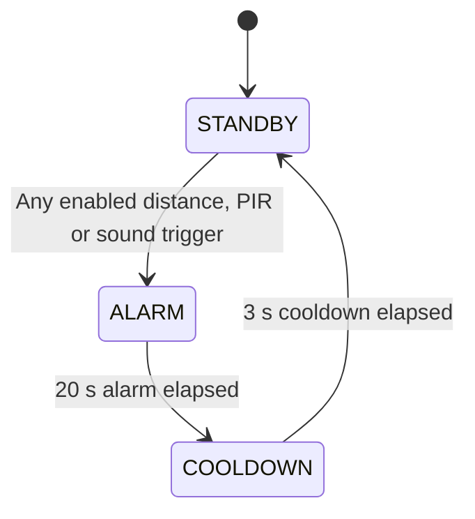

# Hardware engineering case study — Smart Scarecrow

## Project origin and contribution

This work began as a school Smart Scarecrow project. My completed contribution was the Arduino control program for an integrated five-sensor system with two servo arms, RGB indication and a buzzer. The later ML extension investigates a more selective acoustic trigger on the same hardware platform.

The [original master sketch](../firmware/originals/5CCE2EMP_Control_SG90_HC-SR04/5CCE2EMP_Control_SG90_HC-SR04.ino) is preserved unchanged. The school implementation's completion is reported by the author; the source provides inspectable implementation evidence. Measurements added during this extension are identified separately below. No school grade, field reliability rate or mechanical test result is inferred from compilation.

## 1. Integrating five sensors and coordinated outputs

| Device | Pins | Engineering role |
|---|---|---|
| HC-SR04 left / right | D2/D3 and D12/D13, TRIG/ECHO | Two distance channels; 15 ms echo timeout; trigger range 2–50 cm |
| PIR 1 / PIR 2 | D4 / A0 | Two motion channels; detect a fresh LOW-to-HIGH transition |
| Waveshare Sound V2 | AOUT A1, DOUT D5 | Analog sound waveform for FFT; DOUT is connected but unused by the original FFT decision |
| Right / left arm servo | D9 / D10 | Position-controlled arm movement |
| Common-cathode RGB | D6 / D7 / D8 | Red, green and blue status outputs |
| Buzzer | D11 | Alarm output, switched in coordination with movement |

Two ultrasonic modules, two PIR modules and one sound module make **five sensors**. AOUT and DOUT are two outputs of the same sound module, not two separate sensors. A0 is occupied by PIR 2 and D13 by ultrasonic ECHO 2, so neither is a spare test output.

## 2. Original Arduino control behavior

| Firmware responsibility | Original implementation | Why it matters |
|---|---|---|
| Sensor integration | `readUltrasonicDistance()` and the standby branch read both distance channels, both PIR channels and audio | One controller coordinates distinct sensing methods |
| Motion re-arming | Store previous PIR states, confirm rising edges for 150 ms, then apply a 2 s settling window after cooldown | A continuously HIGH PIR does not repeatedly count as a new edge |
| Acoustic filtering | `detectBirdSoundFFT()` samples 64 ADC values, differences adjacent samples, applies Hamming windowing and FFT, and tests the dominant peak against 1,800–4,500 Hz | Adds spectral discrimination beyond a simple loudness comparator |
| Amplitude calibration | Ten startup frames establish a maximum baseline; threshold is baseline + 25 ADC-difference counts | Adapts the amplitude gate to the startup environment |
| Output coordination | `smoothMoveArms()` makes five position steps; alarm alternates servo movement, RGB and buzzer states | Encodes coordinated physical behavior rather than isolated sensor demonstrations |
| Alarm lifecycle | 20 s alarm lockout, 3 s cooldown and a sound-channel quiet/re-enable mechanism | Limits repeated triggers while the scarecrow itself is active |
| Diagnostics | Serial messages show distances, PIR levels, amplitude threshold, dominant frequency and trigger source | Supports checking why an alarm occurred |

The original sketch uses `delay()` and `pulseIn()`. It is a sequential embedded controller, not a hard real-time scheduler. The original 500 ms quiet-rearm logic does not by itself prove continuous quiet across unobserved intervals. Its 9,600 Hz sampling label is nominal, and stepped servo commands do not establish that voltage dips have been eliminated. These are measurable follow-up questions, not reasons to hide the original design.

## 3. Extending and measuring the embedded implementation

| Evidence | Result | Interpretation |
|---|---|---|
| Original master compile | 12,322 B Flash; 1,767 B static SRAM | Only 281 B of the 2 KB SRAM remains for stack and runtime use |
| Separate `legacy_master_fixed` compile | 12,370 B Flash; 939 B static SRAM | `F()` serial strings save 828 B SRAM; original source remains intact |
| Real board capture | 30 complete frames, 7,680 ADC samples | Confirms receipt of actual sensor samples using the existing legacy frame firmware |
| Capture quality | ADC range 462–480; no rail clipping in the observed samples | A narrow observed signal range; not evidence of bird classification or calibrated gain |
| Added firmware | Acquisition, LED controller and full host-controlled master compile | Compilation does not establish real actuator operation |

The separate repair also aligns the FFT's declared sampling frequency with the nominal 104 µs period. It does not remove all acquisition jitter or rewrite the original controller's blocking behavior. The legacy capture has gaps between frames and has no Bird/Non-bird labels, so it is excluded from classifier training and evaluation.

## 4. Connecting the hardware foundation to ML

The engineering question is whether the sound channel can distinguish birds from environmental noises using more information than one dominant frequency. The extension extracts RMS, spectral statistics, band-energy ratios and MFCCs, then compares a fixed software FFT rule with a Random Forest on recording-disjoint data.

There are two distinct integration paths:

1. **Host classification and Arduino control.** A host microphone supplies audio to Python; classifications become serial events. `scarecrow_host_ml` retains the five-sensor pin map and actuator state machine, adds explicit arming and heartbeat handling, and accepts `TRIGGER` as its acoustic event. Its A1/D5 values are telemetry, not the model input.
2. **Waveshare data acquisition.** `uno_audio_capture` streams A1 samples to the host for labelled data collection. This sketch uses Timer1, which conflicts with the AVR Servo library; it is a separate acquisition firmware and does not run both servo arms simultaneously.

The original school firmware remains a standalone controller. The ML extension currently needs a host because a 0.25 s, 9.6 kHz, 16-bit buffer alone needs 4,800 B, exceeding the UNO's entire SRAM. The deployed model is not embedded in the ATmega328P.

The public-data experiment gives 83.75% window accuracy for RF versus 55.78% for the experimental FFT rule, but RF also produces more non-bird false positives. This comparison is **not** a measured improvement over the original physical scarecrow. A useful next experiment needs labelled recordings from the actual microphone/front-end, independent recording sessions, and controlled measurements of acoustic triggers with actuator noise present.

## 5. What to inspect

- [Original Arduino master](../firmware/originals/5CCE2EMP_Control_SG90_HC-SR04/5CCE2EMP_Control_SG90_HC-SR04.ino): the completed school-project control implementation.
- [Separate SRAM repair](../firmware/legacy_master_fixed/legacy_master_fixed.ino): memory-conscious extension without replacing the original.
- [Host-controlled master](../firmware/scarecrow_host_ml/scarecrow_host_ml.ino): the proposed ML event/control interface.
- [Firmware selection guide](../firmware/README.md): which sketch belongs to each stage.
- [Hardware integration guide](HARDWARE_ZH.md): acquisition protocol, timer limits and deployment options.
- [Technical report](TECHNICAL_REPORT_ZH.md): methods, measured results and remaining validation.

## 中文说明：如何理解这项作品

作品的起点是本人已经完成的学校智能稻草人：在 Arduino 上编写五传感器检测和双舵机、LED、蜂鸣器联动程序。原始代码展示的是嵌入式编程、接口分配、传感器集成、状态机和执行器控制能力。

后续机器学习工作围绕其中的声音通道展开：保留原有硬件系统，增加特征提取、分类器和来源独立的评估，再设计主机分类与 Arduino 控制之间的接口。已经得到公开音频实验结果，也采到了真实板子的声音帧；尚未完成的是 Waveshare 连续数据的标注与现场验证，以及新 ML 控制固件的整机动作测试。不能将实验准确率提升直接写成声音传感器本身精度提升或整机误报率已经下降。
