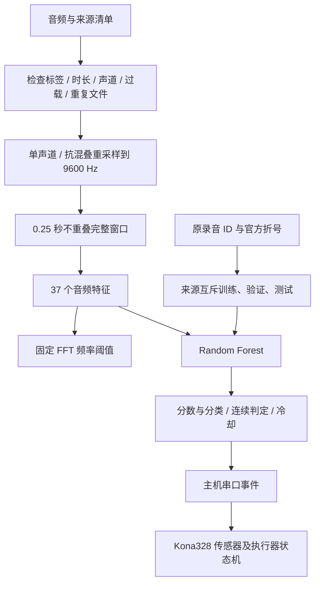
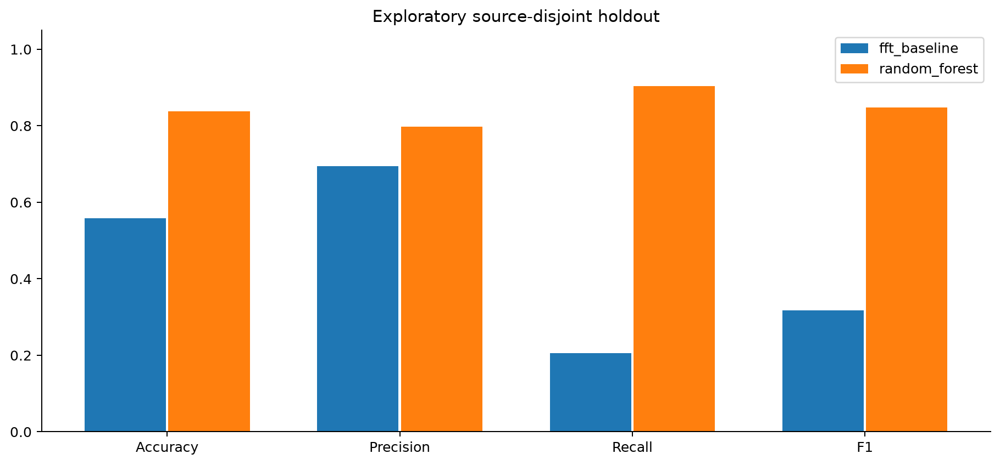
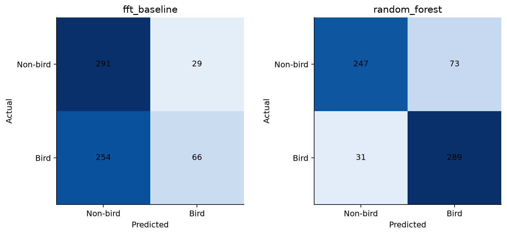
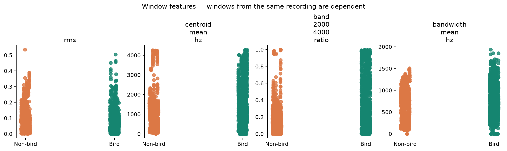

# Smart-Scarecrow-ML 技术报告

日期：2026-11-21。环境：Mac、Python 3.12.6、现有 `.venv`。项目位置：`~/Documents/Smart-Scarecrow-ML`。

## 1. 完成状态与核心结论

已经实现并运行了数据审计、可复用特征提取、FFT 基线、Random Forest、来源分组划分、验证集阈值选择、独立测试、文件推理、实时推理入口和自动绘图。现有 29 个项目文件逐字节保留并备份；另外找到并保存了四份原 Arduino 草图。19 项软件测试通过，依赖一致性检查通过，四份新增或修正版 UNO 固件编译成功。

公开数据实验表明 RF 能显著提升鸟声召回和总体分类准确率，但当前结果 **没有证明误报警少于 FFT 基线**。针对误报的验证集阈值实验也未在测试集上达到预期。真实硬件录音与公开音频的分布不同，当前模型不能称为已完成实地部署。

已通过用户终端运行项目中的新程序，采集并分析 30 个真实 Kona328 声音帧。板子当前运行旧的 115200 文本帧程序；没有烧录任何新固件。GitHub 未发布，音频未上传。

## 2. 数据与来源

原项目含两个原始录音、六份 WAV 派生文件、两条标注、三帧 256 点 ADC 数据和 20 个串口连通性采样。Bird 来源 XC1002645，Non-bird 来源 SELF_VOICE_001。两段标注均为 1.4 秒、9.6 kHz、单声道 PCM16。去直流 RMS 分别为 0.019526 和 0.034292，说明单靠响度不能把这个鸟声和人声样例分开。标注的 verified 状态继承原 CSV，没有声称代理独立听审。

XC1002645 的内嵌元数据记录作者 W. Agster；在线页面拒绝自动访问，许可没有推断成某一种 Creative Commons。自录人声的权属和同意也保留待确认。相关音频均默认忽略，不进入公开交付包。

为补足可运行实验，从固定提交版本的 [ESC-50 官方仓库](https://github.com/karolpiczak/ESC-50) 下载了 160 个真实五秒 WAV，共约 70.6 MB。保存官方 CSV、许可文本、每个文件的原作者链接、Freesound 原录音 ID、官方折号和 SHA-256。[官方许可](https://github.com/karolpiczak/ESC-50/blob/master/LICENSE) 将整个数据集置于 CC BY-NC 3.0 下，同时列出各源录音的署名及许可标签。

正类包括 40 段 chirping_birds 和 40 段 crow；负类包括雨、风、蟋蟀、发动机、吸尘器、脚步、鼓掌、直升机，每类每折固定随机选两段，种子 42。负类源描述中明显提及鸟声的候选在抽样前排除，但这不能保证背景中完全没有鸟。

预处理质量检查排除两段超过 1% 近满幅/超量程的音频。重采样会产生过冲，故这是保守的质量规则，并非断言原始 ADC 已削顶。最终使用 158 段、790 秒、132 个原录音来源，得到 3,160 个窗口：Bird 1,600，Non-bird 1,560。

这些是**片段级弱标注**：一段五秒鸟声不保证每个 250 ms 窗口都有鸟鸣。结果主要描述该公开音景子集的分类能力，不等同于精确鸟鸣事件检测，也不等同于官方 ESC-50 五十分类成绩。软件测试中的正弦波仅用于验证数学和程序行为，没有混入实验数据。

## 3. 整体架构与算法



音频读取支持整数 PCM 的正确归一化、多声道平均和 `resample_poly` 重采样，不做逐文件峰值归一化。每个窗口单独去均值；不把尾部不足 0.25 秒的数据填充为正常窗口，也不把不同录音拼接。特征配置、列顺序、库版本、随机种子及源文件哈希随模型保存，推理复用同一函数。

37 维特征的定义如下：

| 特征 | 数量 | 实现与用途 |
|---|---:|---|
| RMS | 1 | `sqrt(mean((x-mean(x))²))`，描述交流幅度 |
| 过零率 | 1 | 相邻采样符号变化比例 |
| FFT 主峰 | 1 | Hamming 短时功率谱平均后，排除 DC 找最大峰 |
| Spectral Centroid | 2 | 用功率加权的频率均值，取帧均值与标准差 |
| Spectral Bandwidth | 2 | 相对质心的功率加权频率标准差，取均值与标准差 |
| 频带能量比例 | 4 | 0–1k、1–2k、2–4k、4–4.8k Hz 占总功率比例 |
| MFCC | 26 | 13 个系数的均值与标准差 |

STFT 为 256 点、步长 128 点、Hamming 窗；频率分辨率 37.5 Hz。MFCC 使用 HTK Mel 刻度的 26 个三角滤波器、自然对数、正交 DCT-II，取系数 0–12。这里的 centroid/bandwidth 明确定义为功率加权，不能与采用幅度加权的另一软件默认值直接混用。静音、空输入、非有限值和长度不符均有处理或拒绝逻辑。

实验 FFT 基线是预先固定的示例规则：RMS ≥ 0.005 且主峰处于 2,000–4,500 Hz。它用于可复现比较，**不是原主控逐位等价的回放**。后来获得的真实主控使用 64 点 FFT、相邻差分预加重、1,800–4,500 Hz 区间和 `maxBaseline+25` 的 ADC 差分幅度门限。公开 WAV 没有对应传感器增益和启动校准数据，不能编造原固件的实际误报率。原代码和其独立修正版均已保存，可进行后续同条件实机比较。

RF 固定为 200 棵树、最大深度 8、随机种子 42、类别平衡子采样权重，同时按来源窗口数的倒数加权，降低长录音支配训练的程度。没有根据测试集调参。RF 分数是未经概率校准的投票分数，不解释为真实置信概率。

## 4. 防泄漏与评估协议

所有窗口继承原录音的 `source_group`。同一 Freesound `src_file` 的不同 take 保持同组；原始文件哈希和解码音频哈希额外合并完全重复样本。相同音频出现矛盾标签会直接报错。对来源未申报的转码、裁剪或共同录音场景，精确哈希不能完全查出，因此仍需人工来源审查。

默认 RF 使用官方 1–4 折训练、5 折测试。实际训练 2,520 个窗口、104 个来源；测试 640 个窗口、28 个来源、32 段录音（正负各 16 段）。训练与测试来源交集为空。

低误报实验单独保留：1–3 折训练（1,880 窗口），4 折验证（640 窗口、27 来源），5 折测试。阈值只在验证集上选择，目标是在负类 FPR ≤ 5% 的约束下最大化鸟声召回；没有重训后改变分数分布，也没有反复用测试结果调阈值。最终阈值 0.7517421225，验证 FPR 4.375%。

原有私有数据只有每类一个来源，程序明确输出数据不足。切成十个窗口后仍不能独立评估；所有测试指标为 N/A，演示模型不允许驱动执行器。

## 5. 实际实验结果

下面以 Bird 为正类，测试单位为 0.25 秒窗口，正负类各 320 个：

| 方法 | Accuracy | Precision | Recall | F1 | 负类误报率 |
|---|---:|---:|---:|---:|---:|
| FFT 示例基线 | 55.78% | 69.47% | 20.63% | 0.3181 | 9.06% |
| RF，阈值 0.5 | 83.75% | 79.83% | 90.31% | 0.8475 | 22.81% |
| RF，验证集选阈值 | 70.00% | 79.91% | 53.44% | 0.6404 | 13.44% |

混淆矩阵按行是真实 `[Non-bird, Bird]`，列为预测 `[Non-bird, Bird]`：

```text
FFT:                [[291, 29], [254, 66]]
RF @ 0.5:           [[247, 73], [ 31,289]]
RF @ validation:    [[277, 43], [149,171]]
```

两个 RF 使用了不同训练折，不能把两者全部变化归因于阈值。验证集上的低 FPR 没有稳定迁移到测试集；模型仍不能证明比 FFT 少误报。默认 RF 对全部 40 个留出蟋蟀窗口均误判为 Bird，低误报实验也一样，显示鸣虫是关键困难负类。

按五秒片段平均 RF 分数、FFT 多数投票，默认 RF 正确 29/32，Accuracy 90.625%，Precision 88.24%，Recall 93.75%，F1 0.9091；FFT 正确 18/32，Accuracy 56.25%。窗口和片段是不同单位，不能混报。测试只有 28 个来源，窗口间有相关性，没有给出虚假的高精度独立样本置信区间。

将公开数据模型用于原有两段本地录音：Bird 的五个窗口均预测 Bird，但自录人声的五个窗口有四个被误判 Bird。这只是域迁移探查，不是足够规模的新测试，也不能据鸟声五次命中声称 100% 准确率。下一步必须补充语音、鸣虫、舵机/蜂鸣器自噪声和实际农田背景。







模型文件约 2.40 MB，28,476 个树节点。本机测量 100 次“特征提取+RF 推理”，每个窗口中位 3.93 ms、P95 4.17 ms，不含麦克风采集、文件解码和串口等待；这是主机实测，不是 UNO 速度。

## 6. 真正的硬件采集结果

用户关闭 Arduino IDE 监视器后，在自己的 Mac 终端运行新写入的 `capture-legacy`。文件已实际保存并由程序读取分析：

| 项目 | 结果 |
|---|---:|
| 完整帧 / 总采样 | 30 / 7,680 |
| ADC 最小 / 最大 | 462 / 480 |
| 平均 DC 偏置 | 472.145 counts |
| 每帧 RMS 最小 / 中位 / 最大 | 1.616 / 2.162 / 3.531 counts |
| 接近 ADC 电源轨的比例 | 0% |
| 主机相邻帧接收间隔中位数 | 0.565 秒 |
| 被拒绝的不完整或异常帧 | 1 |

这说明采集链能获得结构完整的 ADC 帧，信号摆幅较小；不能仅据这些数值断言有鸟、无人声、无噪声或传感器增益足够。那个被拒帧可能来自打开串口时接入半帧，但日志没有提供足够证据确定原因。原始串口文本、帧 CSV 和分析图均保留。

每帧仅约 26.6 ms，帧接收间隔约 565 ms；不能拼为连续音频，也不能直接输入要求 250 ms 连续数据的模型。原采样源码的 104 μs 参数意味着名义 9,615.38 Hz，不是实测时钟。该批数据保持 `unlabeled`，未加入监督训练。

## 7. 与现有硬件结合

真实接线为 AOUT→A1、DOUT→D5、PIR2→A0、超声波2 ECHO→D13、舵机→D9/D10。新增固件已按此修正。`uno_controller` 使用 D7 绿灯测试，避免错误驱动 D13 的传感器输出线。

推荐当前架构：主机麦克风/USB 音频输入 → Python ML → 串口事件 → Kona328 状态机。完整 `scarecrow_host_ml` 保留两路超声波、两路 PIR、RGB、两舵机和蜂鸣器，默认 DISARMED；新鲜心跳+显式 ARM 后才启用动作。主机声学结果替代声音 FFT 触发，其他传感器仍独立触发并记录报警来源。当前所有动作策略仍需实机验证，未自动启用。

Waveshare 真正音频的数据采集采用独立 `uno_audio_capture`，在 A1 用定时器以名义 8 kHz 连续采样，包序号、CRC 和丢样计数用于检查连续性。Timer1 与 Servo 冲突，所以该模式不运行舵机控制，不能与完整主控直接合并。详见 [硬件文档](HARDWARE_ZH.md)。

ATmega328P 的 2 KB SRAM 无法容纳当前 4,800 B 音频窗口，更无法直接运行完整 MFCC 和 2.40 MB RF。原主控静态 SRAM 为 1,767 B，独立修正版通过 `F()` 降为 939 B；完整主机 ML 控制版静态 SRAM 为 356 B。所有数字来自实际编译，不等于运行时栈和电源安全已验证。

纯单片机部署的可行后续是：少量定点频带能量/Goertzel/RMS + 重新训练的浅决策树，逐样本验证量化误差与真实时序。不能直接把现有 joblib 拷入 UNO。8 kHz 前端最多保留 4 kHz 带宽，重采样不会恢复失去的高频，后续训练必须匹配硬件前端。

## 8. 保留、验证与仍需人工完成的事项

- 原有程序、CSV、WAV、图表未覆盖；29 个初始文件哈希复核通过。原 Arduino 文件也未修改。修正都在独立包、独立固件及新结果目录中。
- 软件测试覆盖音调频率和 RMS、DC/静音、PCM 与重采样、重复/矛盾标签、来源互斥、阈值验证隔离、模型演示保护、独占写入、CRC/断包、旧协议帧检查和动作去抖。19 项通过。
- 四份新增/修正版固件成功编译；Arduino 核心自带 `new.cpp` 存在未使用参数警告，不来自项目逻辑。未上传固件、未用代理触发舵机或蜂鸣器。
- 实际交付 README、运行指南、数据卡、硬件指南、技术报告、依赖及锁定版本、`.gitignore`、CI 配置、来源清单、训练表、模型、图表和测试日志。
- 后续需要用户确认录音许可和语音同意、选择代码许可证、审听新采集音频并标注；使用连续采集模式补足目标域数据；保留机械限位/电源检查后再进行 LED、控制协议和真实执行器测试；最后按录音会话/日期/地点保留全新测试集，测量每小时误报警与漏检事件。

“公共音频分类流程已完成”和“现场误报目标已实现”是两个不同结论；本项目目前能够支持前者，尚不能证明后者。
